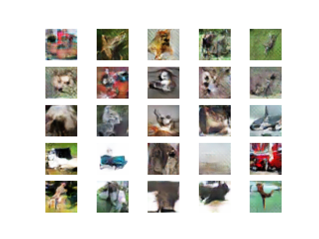

# Deep Learning Models

Four deep learning projects built with TensorFlow and Keras, each in its own folder with a fully executed notebook:

| # | Project | Task | Headline result |
|---|---|---|---|
| 01 | [GAN and VAE image generation](01-gan-vae-image-generation) | Generate CIFAR-10 images with a DCGAN, a conditional DCGAN and a conditional VAE | Best DCGAN reaches **FID 86.2**, down from 108.1 for the first run |
| 02 | [DQN pendulum control](02-dqn-pendulum-control) | Train a Deep Q-Network to swing up and balance a pendulum | Cosine epsilon decay with 5 discrete actions was the most reliable agent |
| 03 | [ResNet handwritten letters](03-resnet-handwritten-letters) | Classify the 26 EMNIST letters | **94.2% test accuracy**, compared with 89.2% for the plain CNN baseline |
| 04 | [BiGRU and attention sentiment](04-bigru-attention-sentiment) | Classify customer pizza reviews as positive or negative | **87.1% mean test accuracy** across three random seeds |

Projects 01 and 02 were team projects with Han Qian and Liew Zheng Hao. Projects 03 and 04 are individual research extensions.

---

## 01 · GAN and VAE image generation on CIFAR-10

<p align="center"></p>

**DCGAN** ([`dcgan_cifar10.ipynb`](01-gan-vae-image-generation/dcgan_cifar10.ipynb))

- A baseline DCGAN followed by ten tuned versions (v1 to v10), each changing one aspect of the setup: generator and discriminator depth, learning rates, label smoothing, dropout, or the number of training epochs.
- v9 and v10 are **conditional DCGANs**: the class label is embedded and fed to both networks, so the generator can produce a requested class.
- Every model is scored with the **Fréchet Inception Distance (FID)**, where lower is better. Failed runs are kept and explained alongside the successful ones.

| Model | FID |
|---|---|
| **v5** | **86.2** |
| v10 (conditional) | 96.5 |
| v7 | 105.0 |
| v1 (first run) | 108.1 |
| v3 (collapsed) | 601.7 |

The [side-by-side grid](01-gan-vae-image-generation/images/all_models_side_by_side.png) shows every model generating from the same fixed noise seed, which makes mode collapse in the failed runs easy to see.

**Conditional VAE** ([`cvae_cifar10.ipynb`](01-gan-vae-image-generation/cvae_cifar10.ipynb))

- A convolutional VAE trained on CIFAR-10 and extended to be class-conditional.
- Reconstruction-loss experiments covering binary cross-entropy, MSE, a hybrid pixel and **SSIM** loss, a **beta-weighted KL** term, **KL annealing** and an **edge-aware** (Sobel) loss, with sweeps over loss weights and dropout.
- Latent-space analysis: class interpolations, class-conditional sampling and single-dimension latent walks.

## 02 · Deep Q-Network for pendulum control

[`dqn_pendulum.ipynb`](02-dqn-pendulum-control/dqn_pendulum.ipynb)

- A DQN agent for OpenAI Gym's `Pendulum` environment, with the continuous torque split into a fixed number of discrete actions.
- Main and target networks, an experience replay buffer, and weight saving and loading.
- Controlled experiments on the exploration schedule (fixed epsilon, then exponential decay compared with **cosine decay**), on how finely the action space is split, and on training length.
- The agent with **cosine decay and 5 actions** gave the best and most stable reward, and was then tested for generalisation under different gravity settings.

## 03 · ResNet-style CNN for handwritten letters

[`resnet_emnist_letters.ipynb`](03-resnet-handwritten-letters/resnet_emnist_letters.ipynb)

This project tests whether residual connections help on 28×28 handwritten letters (EMNIST Letters, 26 classes) when compared fairly against plain CNNs.

| Model | Parameters | Validation accuracy | Test accuracy |
|---|---|---|---|
| **ResNet-inspired CNN** | 681,658 | 94.8% | **94.2%** |
| Baseline CNN | 594,138 | 89.3% | 89.2% |
| Deeper plain CNN | 66,970 | 88.8% | 88.3% |

The residual model gains 5 points of accuracy over the baseline with a similar number of parameters. The notebook also includes a confusion-matrix analysis of the letters the model gets wrong.

The earlier stage of this work is in [`cnn_eda_and_baseline.ipynb`](03-resnet-handwritten-letters/cnn_eda_and_baseline.ipynb). It covers exploratory analysis of the dataset (class balance, image orientation and pixel statistics) and the first convolutional network, which reached about 92% accuracy on the 17,760 held-out test images. The ResNet extension was built on top of this work.

> The EMNIST Letters CSV (about 200 MB) is not included. Download `emnist-letters.csv` from Kaggle and place it next to the notebooks.

## 04 · Attention-based bidirectional GRU for review sentiment

[`bigru_attention_sentiment.ipynb`](04-bigru-attention-sentiment/bigru_attention_sentiment.ipynb)

This project compares a GRU, a bidirectional GRU, and a bidirectional GRU with an additive attention layer on 900 short customer reviews ([`pizza_reviews.csv`](04-bigru-attention-sentiment/pizza_reviews.csv)) labelled from their 1 to 10 scores. Each model is trained with three random seeds (7, 19 and 42), and the results are reported as means rather than single best runs.

| Model | Mean test accuracy | Mean test macro F1 |
|---|---|---|
| GRU | 85.4% | 0.842 |
| **Bidirectional GRU** | **87.1%** | **0.861** |
| Bidirectional GRU and attention | 85.4% | 0.843 |

Attention produced the single best run (89.4% accuracy, 0.886 macro F1) but varied the most between seeds. On a dataset this small, the plain bidirectional GRU was the more dependable choice. Per-seed results are in [`seed_results.csv`](04-bigru-attention-sentiment/seed_results.csv).

---

## Running the notebooks

```bash
pip install tensorflow numpy pandas matplotlib scikit-learn gym jupyter
jupyter notebook
```

CIFAR-10 downloads automatically through `tf.keras.datasets`. A GPU is recommended for the GAN and VAE notebooks.

## Tech stack

Python · TensorFlow · Keras · NumPy · pandas · Matplotlib · scikit-learn · OpenAI Gym · Jupyter
